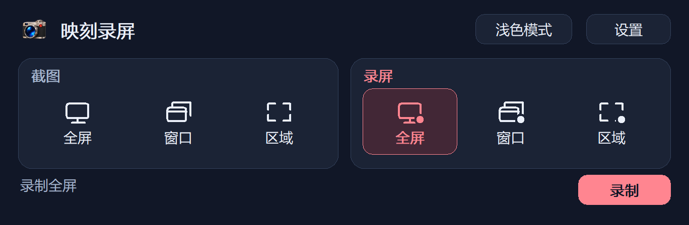
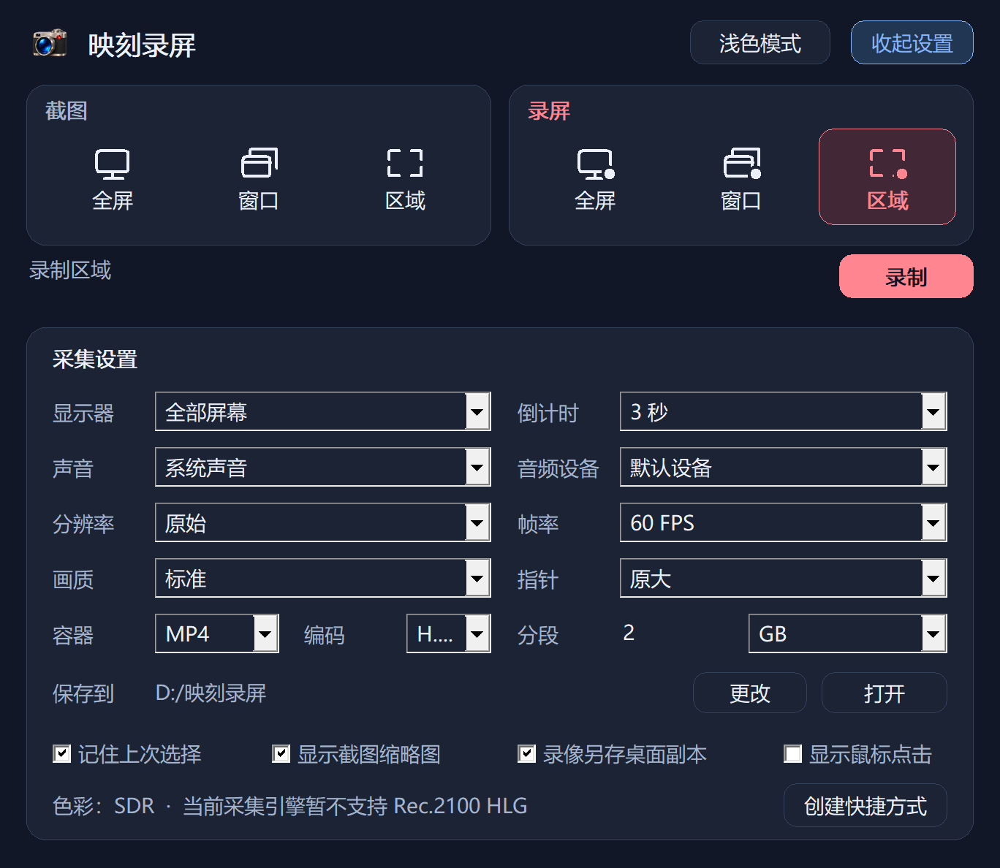

<p align="center">
  
</p>

# 映刻录屏

映刻录屏是一款用于 Windows 和银河麒麟的轻量截图、录屏工具，原名拾影录屏。它把全屏、窗口和区域的截图与录制集中在一条工具栏中。免安装版包含录制引擎，解压即可离线使用，日常运行无需管理员权限。

## 界面

首次启动默认使用深色主题。点右上角可在浅色与深色之间切换，软件会记住上次选择。约 0.62 秒的开场动画在标题左侧完成，工具栏从首帧起即可操作。




展开「设置」可修改显示器、音源、画质、帧率、保存位置等选项。下图的路径是用于演示的示例。



截图由当前 Windows 版的界面渲染生成。

## 支持平台

| 平台 | 运行条件 | 免安装包 |
| --- | --- | --- |
| Windows 10 及以上 | x86_64 | Windows ZIP |
| 银河麒麟桌面版 V10 | x86_64，X11 会话 | Linux x86_64 TAR.GZ 或 ZIP |
| 银河麒麟桌面版 V10（飞腾等） | arm64 / aarch64，X11 会话 | 飞腾 ARM64 TAR.GZ 或 ZIP |

Linux 版基于 X11，运行需要 glibc 2.17 或更新版本。音频采集需要 PulseAudio，Wayland 会话不支持。各系统的公开下载和校验文件见 [GitHub Releases](https://github.com/Yuqing-Maniac/shiying/releases)。历史标签 [shiying-v1.1.0](https://github.com/Yuqing-Maniac/shiying/releases/tag/shiying-v1.1.0) 的资产是拾影录屏。本文描述当前源码构建出的映刻录屏。

## 快速上手

1. **启动。** 将整个压缩包解压到本机磁盘。Windows 双击 `映刻录屏.exe`，麒麟运行 `./映刻录屏`。请把 `录制引擎` 目录留在程序旁边。
2. **选择范围。** 在工具栏选择截图或录屏，再选全屏、窗口或区域。多屏用户可以在设置里指定屏幕。
3. **开始采集。** 选好模式后点击「截取」或「录制」。窗口模式点击一个窗口，区域模式用鼠标拖选，右键或 Esc 可取消。录制中可以暂停、继续和停止。
4. **找到文件。** 截图以原尺寸 PNG 保存，可显示缩略图。录像停止后自动保存到设置中的目录，通常还会在系统桌面留一份副本。原件已在桌面时只保存一次，可以在设置中关闭副本。

窗口模式采集所选窗口在屏幕上的可见范围。录制时移动窗口、或用别的窗口挡住它，会影响画面。

在 Windows 的「设置」中可创建桌面和开始菜单快捷方式。麒麟运行包内的 `./安装到菜单.sh` 创建入口，移除入口时运行 `./卸载.sh`。升级包保留旧启动文件名，供同目录更新时的既有快捷方式使用。移动免安装目录后，从新目录重建快捷方式和任务栏固定项。

## 采集选项

| 选项 | 可用设置 |
| --- | --- |
| 声音 | 无声、系统声音、麦克风、系统声与麦克风混录，或选择单个输入设备 |
| 分辨率和帧率 | 原始尺寸、1080P、720P。10、15、24、30、60 FPS |
| 编码和容器 | H.264、H.265。MP4、MKV。实际可用项取决于随包引擎 |
| 录制辅助 | 倒计时、鼠标指针及点击高亮、记住上次选择 |
| 分段和恢复 | 默认按 2 GB 分段。已封存分段可以直接播放，异常退出后重新打开会尝试恢复最后一段 |

60 FPS 为恒定输出帧率，机器采集速度不足时会重复帧。当前采集链路输出 SDR，未接入原生 Rec.2100 HLG。

| 全局快捷键 | 操作 |
| --- | --- |
| Ctrl+Alt+R | 开始或停止录制 |
| Ctrl+Alt+P | 暂停或继续 |
| Ctrl+Alt+H | 隐藏或显示录制界面 |

## 自检和构建

Windows 可在程序目录运行 `映刻录屏.exe --check`，麒麟运行 `./映刻录屏 --check`。自检报告录制引擎是否可用。故障排查可以查看用户目录下的 `.cache/shiying/`，配置文件位于 `.config/shiying/config.ini`。

应用界面使用原生 Win32 或 X11，录像由包内 FFmpeg 负责采集和编码。在具备依赖的 Linux 构建环境中可以构建三种免安装包。

```bash
bash build/build_all.sh
bash tests/run_tests.sh
```

产物写入 `_work/dist/`。工具链、各平台依赖和单独构建方法见 [开发说明](CLAUDE.md)。FFmpeg 的分发和许可说明随包提供。[FFmpeg 许可说明](build/package/LICENSE-ffmpeg.txt)
